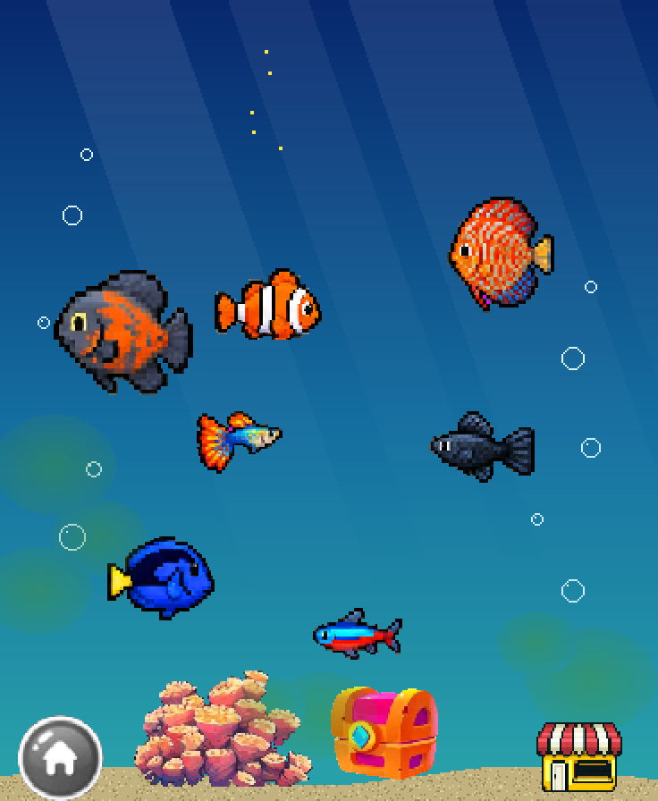
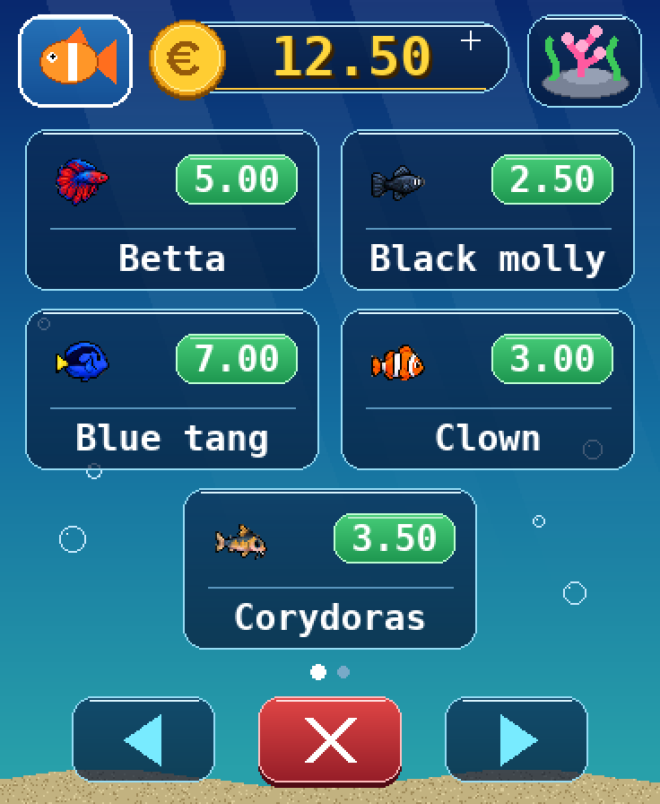
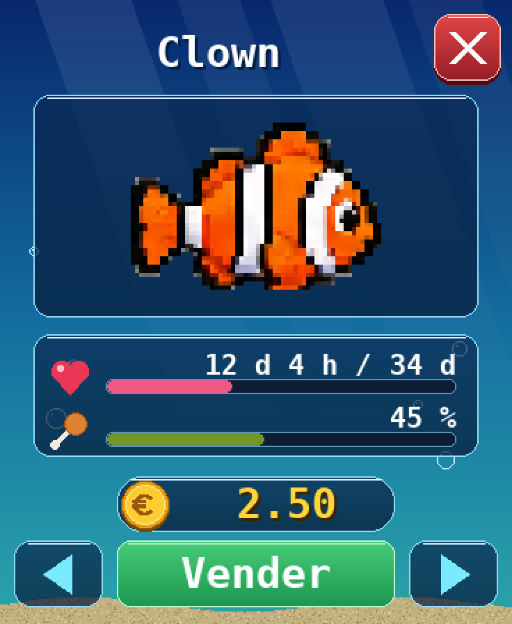
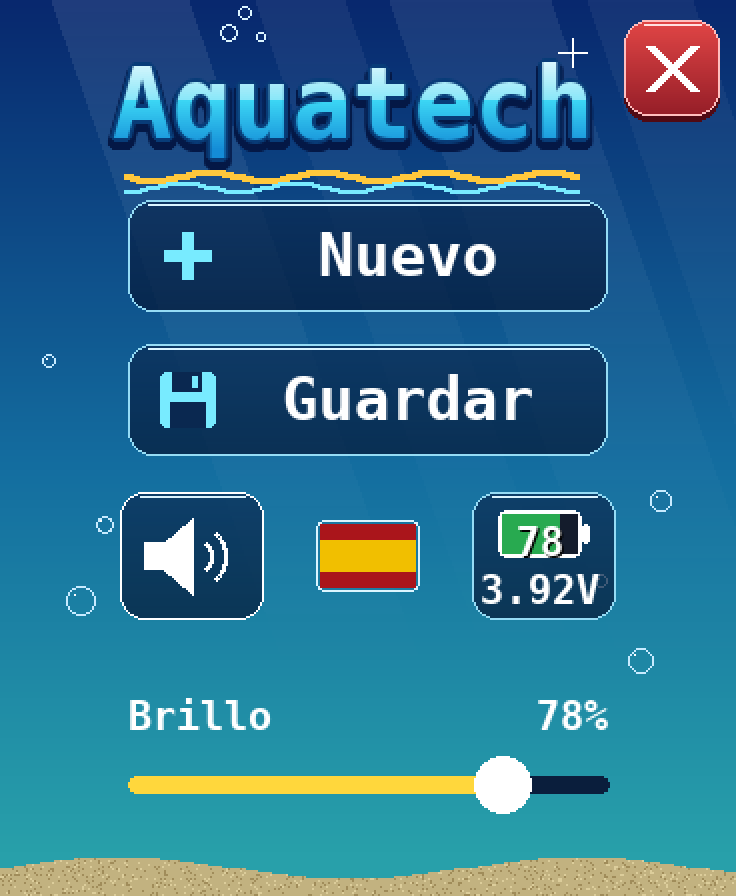

  &nbsp;<a href="README.md">English</a>&nbsp;&nbsp;
  &nbsp;<a href="README.fr.md">Français</a>&nbsp;&nbsp;
  &nbsp;<a href="README.es.md"><b>Español</b></a>&nbsp;&nbsp;

# 🐠 Aquatech

**Un acuario virtual para la pantalla Waveshare ESP32-S3 AMOLED 1.8"**

Instalación con un clic desde el navegador, sin ninguna herramienta de desarrollo.

 

---

## ✨ Presentación

Aquatech convierte la pequeña pantalla AMOLED de Waveshare en un acuario vivo. Compra peces, aliméntalos, decora el acuario y limpia las algas. El juego sigue la hora real: tus peces crecen y envejecen incluso cuando la pantalla está en reposo.

### Funciones

- 🐠 **10 especies**: Neon, Guppy, Black molly, Clown, Corydoras, Loach, Betta, Blue tang, Oscar y Discus. Cada una tiene su precio, su velocidad y su esperanza de vida.
- 🍤 **Alimentación**: toca la parte superior de la pantalla para soltar comida. Un pez olvidado demasiado tiempo muere y deja un esqueleto.
- 🧽 **Algas y esponja**: quita las algas con el dedo o adopta un Black molly o un Blue tang que se las comen.
- 💶 **Economía**: empiezas con 10 €, recibes una renta diaria, compras decorados y vendes peces.
- 🪸 **Decorados**: corales, cofre, plantas, rocas… al fondo o en primer plano.
- 🌍 **3 idiomas**: francés, inglés y español. Sonido y brillo ajustables, guardado automático.

## 📸 Capturas de pantalla

<table>
  <tr>
    <td align="center"> <b>El acuario</b></td>
    <td align="center"> <b>La tienda</b></td>
    <td align="center"> <b>La ficha de un pez</b></td>
    <td align="center"> <b>El menú</b></td>
  </tr>
</table>

## 📖 Manual de usuario

<table>
  <tr>
    <td align="center"><a href="manuels/Aquatech_manual_de_usuario.pdf"> <b>Español</b></a></td>
    <td align="center"><a href="manuels/Aquatech_user_guide.pdf"> <b>English</b></a></td>
    <td align="center"><a href="manuels/Aquatech_mode_d_emploi.pdf"> <b>Français</b></a></td>
  </tr>
</table>

## 🔧 Aparato necesario

Aquatech está diseñado para la placa **[Waveshare ESP32-S3-Touch-AMOLED-1.8](https://www.waveshare.com/esp32-s3-touch-amoled-1.8.htm)** (unos 30 €).

| | |
|---|---|
| **Procesador** | ESP32-S3R8, doble núcleo LX7 240 MHz, Wi-Fi + Bluetooth LE |
| **Memoria** | 16 MB flash · 8 MB PSRAM |
| **Pantalla** | AMOLED táctil de 1,8", 368 × 448 px, 16,7 M de colores |
| **Sensores** | IMU de 6 ejes, reloj RTC |
| **Audio** | Micrófono y altavoz integrados |
| **Alimentación** | USB-C, batería LiPo de 3,7 V opcional |

> [!WARNING]
> Waveshare vende varias pantallas muy parecidas (1,43", 1,75", 2,06"… y una versión **ESP32-C6** de la de 1,8"). **Solo el modelo ESP32-S3-Touch-AMOLED-1.8 es compatible.**

También necesitas:
- un **cable USB-C que transmita datos** (no uno que solo cargue);
- un ordenador con **Google Chrome** o **Microsoft Edge**.

## 🚀 Instalación

1. Conecta la pantalla al ordenador por USB-C.
2. Abre **[bgotech.github.io/aquarium](https://bgotech.github.io/aquarium/?lang=es)** en Chrome o Edge.
3. Haz clic en **«Instalar en mi pantalla»** y elige el puerto de la placa.
4. Espera alrededor de un minuto: Aquatech se inicia solo.

Para **actualizar**, vuelve a la página y repite la instalación.

## 🛟 Solución de problemas

<b>La placa no aparece en la lista</b>

Prueba otro cable. Si no: desconecta la placa, mantén pulsado el botón **BOOT**, vuelve a conectarla, suelta el botón e inténtalo de nuevo.

<b>El botón de instalación no aparece</b>

Usa Chrome, Edge u Opera en un ordenador. Firefox y Safari no admiten la instalación desde el navegador (WebSerial).

<b>La pantalla se queda negra tras la instalación</b>

Desconecta y vuelve a conectar la placa. Si hace falta, repite la instalación aceptando el borrado completo.

---

Instalación impulsada por <a href="https://esphome.github.io/esp-web-tools/">ESP Web Tools</a>

