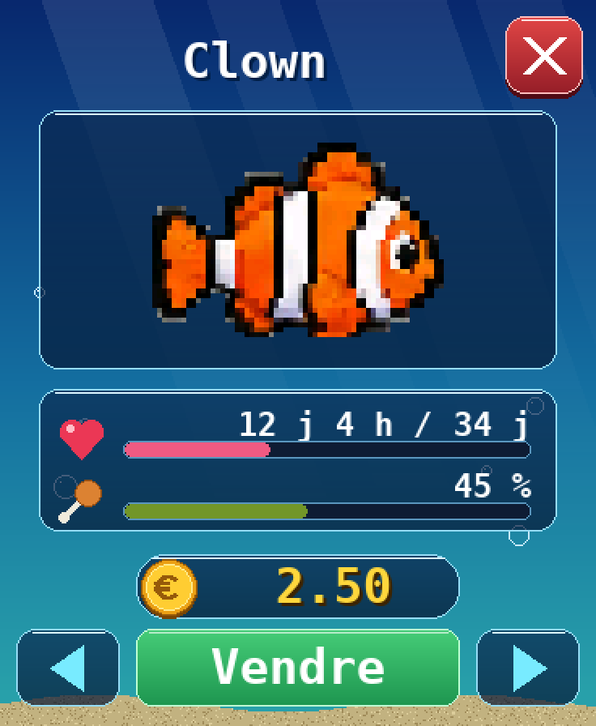
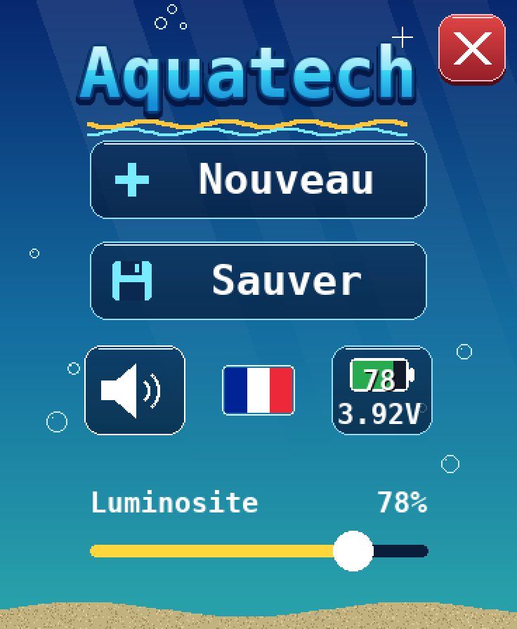

  &nbsp;<a href="README.md">English</a>&nbsp;&nbsp;
  &nbsp;<a href="README.fr.md"><b>Français</b></a>&nbsp;&nbsp;
  &nbsp;<a href="README.es.md">Español</a>&nbsp;&nbsp;

# 🐠 Aquatech

**Un aquarium virtuel pour l'écran Waveshare ESP32-S3 AMOLED 1.8"**

Installation en un clic depuis votre navigateur, sans aucun outil de développement.

 

---

## ✨ Présentation

Aquatech transforme le petit écran AMOLED de Waveshare en aquarium vivant. Achetez vos poissons, nourrissez-les, décorez le bac et nettoyez les algues. Le jeu suit l'heure réelle : vos poissons grandissent et vieillissent même quand l'écran est en veille.

### Fonctionnalités

- 🐠 **16 espèces** : 10 poissons (Neon, Guppy, Black molly, Clown, Corydoras, Loach, Betta, Blue tang, Oscar et Discus), plus le Poisson globe qui se gonfle quand on l'effraie, la Méduse qui pulse, l'Hippocampe qui reste près des décors, l'Écrevisse et l'Axolotl qui marchent sur le sable, et l'Escargot qui grimpe aux vitres. Chacun a son prix, son comportement et sa durée de vie.
- 🍤 **Nourrissage** : touchez le haut de l'écran pour lâcher de la nourriture. Un animal oublié trop longtemps meurt et laisse un squelette.
- 🧽 **Algues et éponge** : effacez les algues du doigt, ou adoptez un Black molly, un Blue tang ou un Escargot qui les broutent.
- 💶 **Économie** : départ à 10 €, une rente quotidienne, des décors à acheter et des animaux à revendre.
- 🪸 **Décors** : coraux, coffre, plantes, rochers… à placer au fond ou au premier plan.
- 🌍 **3 langues** : français, anglais et espagnol. Son et luminosité réglables, sauvegarde automatique.

## 📸 Captures d'écran

<table>
  <tr>
    <td align="center"> <b>L'aquarium</b></td>
    <td align="center"> <b>La boutique</b></td>
    <td align="center"> <b>La fiche d'un poisson</b></td>
    <td align="center"> <b>Le menu</b></td>
  </tr>
</table>

## 📖 Mode d'emploi

<table>
  <tr>
    <td align="center"><a href="manuels/Aquatech_mode_d_emploi.pdf"> <b>Français</b></a></td>
    <td align="center"><a href="manuels/Aquatech_user_guide.pdf"> <b>English</b></a></td>
    <td align="center"><a href="manuels/Aquatech_manual_de_usuario.pdf"> <b>Español</b></a></td>
  </tr>
</table>

## 🔧 Matériel requis

Aquatech est conçu pour la carte **[Waveshare ESP32-S3-Touch-AMOLED-1.8](https://www.waveshare.com/esp32-s3-touch-amoled-1.8.htm)** (environ 30 €).

| | |
|---|---|
| **Processeur** | ESP32-S3R8, double cœur LX7 240 MHz, Wi-Fi + Bluetooth LE |
| **Mémoire** | 16 Mo flash · 8 Mo PSRAM |
| **Écran** | AMOLED 1,8" tactile, 368 × 448 px, 16,7 M de couleurs |
| **Capteurs** | IMU 6 axes, horloge RTC |
| **Audio** | Micro et haut-parleur intégrés |
| **Alimentation** | USB-C, batterie LiPo 3,7 V optionnelle |

> [!WARNING]
> Waveshare vend plusieurs écrans très proches (1,43", 1,75", 2,06"… et une version **ESP32-C6** du 1,8"). **Seul le modèle ESP32-S3-Touch-AMOLED-1.8 est compatible.**

Il vous faut aussi :
- un **câble USB-C qui transmet les données** (pas un câble de charge seule) ;
- un ordinateur avec **Google Chrome** ou **Microsoft Edge**.

## 🚀 Installation

1. Branchez l'écran à votre ordinateur en USB-C.
2. Ouvrez **[bgotech.github.io/aquarium](https://bgotech.github.io/aquarium/?lang=fr)** dans Chrome ou Edge.
3. Cliquez sur **« Installer sur mon écran »** et choisissez le port de la carte.
4. Patientez environ une minute : Aquatech démarre tout seul.

Pour **mettre à jour**, revenez simplement sur la page et relancez l'installation.

## 🛟 Dépannage

<b>La carte n'apparaît pas dans la liste</b>

Essayez un autre câble. Sinon : débranchez la carte, maintenez le bouton **BOOT**, rebranchez-la, relâchez le bouton et réessayez.

<b>Le bouton d'installation n'apparaît pas</b>

Utilisez Chrome, Edge ou Opera sur ordinateur. Firefox et Safari ne gèrent pas l'installation par navigateur (WebSerial).

<b>L'écran reste noir après l'installation</b>

Débranchez et rebranchez la carte. Si besoin, relancez l'installation en acceptant l'effacement complet.

---

Installation propulsée par <a href="https://esphome.github.io/esp-web-tools/">ESP Web Tools</a>

