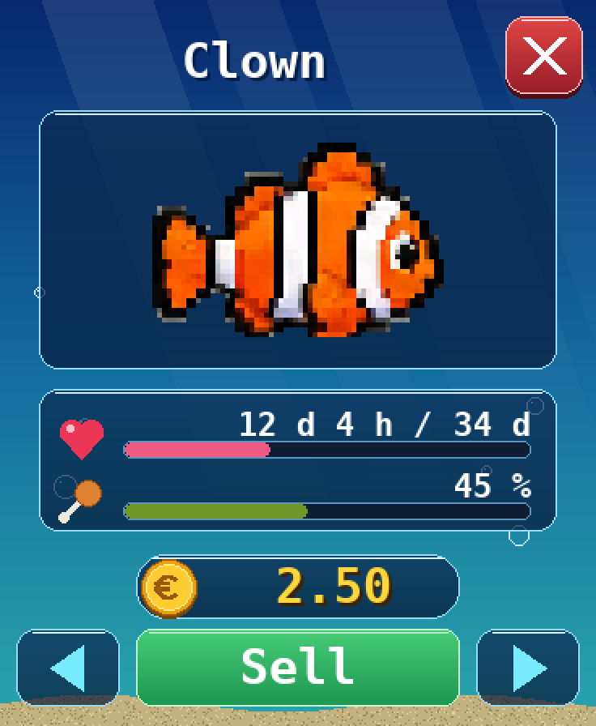
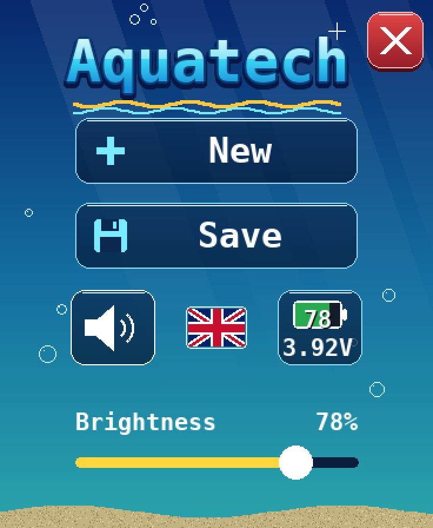

  &nbsp;<a href="README.md"><b>English</b></a>&nbsp;&nbsp;
  &nbsp;<a href="README.fr.md">Français</a>&nbsp;&nbsp;
  &nbsp;<a href="README.es.md">Español</a>&nbsp;&nbsp;

# 🐠 Aquatech

**A virtual aquarium for the Waveshare ESP32-S3 AMOLED 1.8" screen**

One-click install from your browser, no development tools needed.

 

---

## ✨ Overview

Aquatech turns Waveshare's little AMOLED screen into a living aquarium. Buy fish, feed them, decorate the tank and clean off the algae. The game runs on real time: your fish grow and age even while the screen is asleep.

### Features

- 🐠 **16 species**: 10 fish (Neon, Guppy, Black molly, Clown, Corydoras, Loach, Betta, Blue tang, Oscar and Discus), plus the Pufferfish that inflates when scared, the pulsing Jellyfish, the Seahorse that stays near the decorations, the Crayfish and the Axolotl that walk on the sand, and the Snail that climbs the glass. Each has its own price, behaviour and lifespan.
- 🍤 **Feeding**: tap the top of the screen to drop food. An animal left hungry for too long dies and leaves a skeleton.
- 🧽 **Algae and sponge**: wipe algae off with a finger, or adopt a Black molly, a Blue tang or a Snail to graze on it.
- 💶 **Economy**: start with €10, earn a daily income, buy decorations and sell animals.
- 🪸 **Decorations**: corals, a chest, plants, rocks… placed in the background or the foreground.
- 🌍 **3 languages**: French, English and Spanish. Adjustable sound and brightness, automatic saving.

## 📸 Screenshots

<table>
  <tr>
    <td align="center"> <b>The aquarium</b></td>
    <td align="center"> <b>The shop</b></td>
    <td align="center"> <b>A fish's card</b></td>
    <td align="center"> <b>The menu</b></td>
  </tr>
</table>

## 📖 User guide

<table>
  <tr>
    <td align="center"><a href="manuels/Aquatech_user_guide.pdf"> <b>English</b></a></td>
    <td align="center"><a href="manuels/Aquatech_mode_d_emploi.pdf"> <b>Français</b></a></td>
    <td align="center"><a href="manuels/Aquatech_manual_de_usuario.pdf"> <b>Español</b></a></td>
  </tr>
</table>

## 🔧 Required hardware

Aquatech is designed for the **[Waveshare ESP32-S3-Touch-AMOLED-1.8](https://www.waveshare.com/esp32-s3-touch-amoled-1.8.htm)** board (about $30).

| | |
|---|---|
| **Processor** | ESP32-S3R8, dual-core LX7 240 MHz, Wi-Fi + Bluetooth LE |
| **Memory** | 16 MB flash · 8 MB PSRAM |
| **Display** | 1.8" touch AMOLED, 368 × 448 px, 16.7 M colours |
| **Sensors** | 6-axis IMU, RTC clock |
| **Audio** | Built-in microphone and speaker |
| **Power** | USB-C, optional 3.7 V LiPo battery |

> [!WARNING]
> Waveshare sells several very similar screens (1.43", 1.75", 2.06"… and an **ESP32-C6** version of the 1.8"). **Only the ESP32-S3-Touch-AMOLED-1.8 is compatible.**

You also need:
- a **USB-C cable that carries data** (not a charge-only cable);
- a computer with **Google Chrome** or **Microsoft Edge**.

## 🚀 Installation

1. Connect the screen to your computer with USB-C.
2. Open **[bgotech.github.io/aquarium](https://bgotech.github.io/aquarium/?lang=en)** in Chrome or Edge.
3. Click **“Install on my screen”** and pick the board's port.
4. Wait about a minute: Aquatech starts by itself.

To **update**, just come back to the page and run the installation again.

## 🛟 Troubleshooting

<b>The board doesn't show up in the list</b>

Try another cable. Otherwise: unplug the board, hold the **BOOT** button, plug it back in, release the button and try again.

<b>The install button doesn't appear</b>

Use Chrome, Edge or Opera on a computer. Firefox and Safari don't support browser-based installation (WebSerial).

<b>The screen stays black after installation</b>

Unplug and replug the board. If needed, run the installation again and accept the full erase.

---

Installation powered by <a href="https://esphome.github.io/esp-web-tools/">ESP Web Tools</a>

